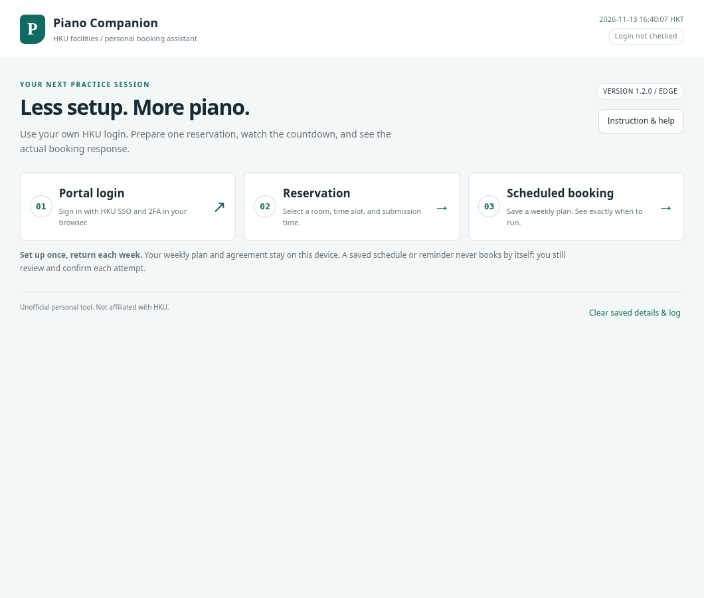
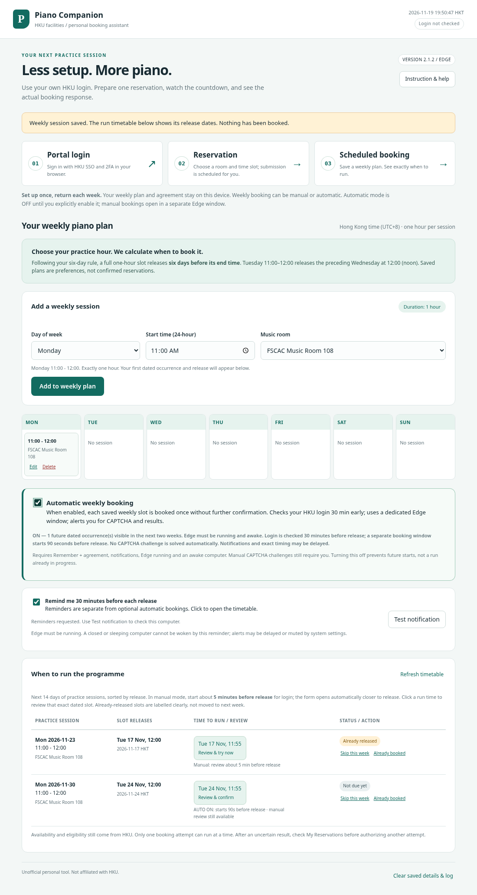
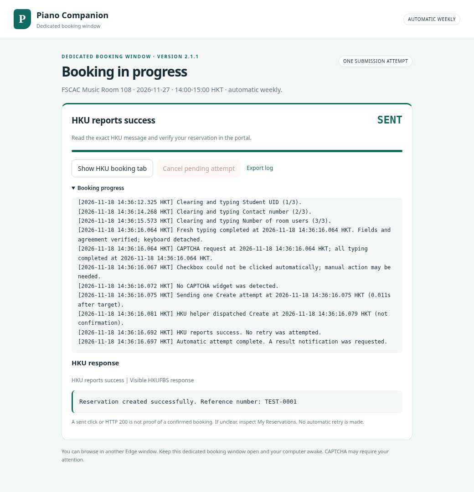

# HKU Piano Companion v2.1.3

**An unofficial Microsoft Edge extension for personal HKU music-room reservations.**

Select a one-hour room slot, or save a weekly timetable. The extension prepares the HKUFBS form in a **separate Edge window**, requests one reCAPTCHA checkbox interaction, and checks the actual portal response. An optional **Automatic weekly booking** switch makes a single attempt for each eligible saved weekly occurrence without another manual confirmation.

This copy is intended for individual evaluation; please do not redistribute or resell it without the project owner's permission.

**Not affiliated with or endorsed by HKU.** The software is experimental, not a guaranteed reservation service. The latest tests used simulated HKU pages, not a live reservation.

## Install or update

1. Download and extract the repository ZIP.
2. Open `edge://extensions` in Microsoft Edge, and enable **Developer mode**.
3. Choose **Load unpacked**, then select the extracted folder containing `manifest.json`.
4. Pin **HKU Piano Companion** in Edge's Extensions menu. Click it to open the companion.
5. For an update from v1.x, **replace the files in the same installed folder**, click **Reload** in `edge://extensions`, and reopen the companion. Avoid removing the installed extension if you want to keep its existing saved preferences.

The extension uses **Chrome/Edge debugger permission** for keyboard-level entry in the specifically selected HKU tab. Approve permissions only if you trust the local source. No Python, Node.js or `auth.json` is required for ordinary use.

## First-time setup

1. Click **Portal login** and complete HKU SSO/2FA.
2. Open **Reservation**. Enter your student UID, phone number, and number of room users. Leave **Remember** checked so your saved weekly schedule can use these details later.
3. Read the room rules, then check **I have read the agreement**. You can revoke this saved consent any time.
4. Choose a room and a whole-hour session, e.g. **14:00-15:00**. The extension only supports one full hour, on the hour.
5. Consider a safe rehearsal: tick **Test only** and confirm. It fills the form but never clicks Create. **Test only is OFF by default**, so check it deliberately for rehearsals.
6. Turn on desktop notifications in Edge and Windows/macOS, and use **Test notification** in Scheduled booking.

## One-off booking - a separate Edge window

1. Under **Reservation**, set the room, date, and start/end time. Submission and CAPTCHA timing are managed automatically in this edition, including a fixed manual-verification window. You can import a recognized booking link from the real HKUFBS calendar, but a listed time is not a guaranteed available slot.
2. Click **Review reservation** and check the summary, then **Confirm live booking**.
3. The extension immediately opens a **dedicated Edge booking window**. After that, **you may close the original companion** without cancelling this attempt. Do not close the dedicated booking window.
4. Inside that new Edge window, the assistant validates your HKU login and opens a separate HKU tab. It clears and freshly retypes all three fields, even when they already contain your saved values.
5. If CAPTCHA requires an image or audio challenge, the booking window alerts you and brings the HKU tab forward. **Solve the challenge manually.**
6. After verification, the assistant attempts **Create exactly once** at its scheduled target. It displays the captured HKUFBS response and leaves the site open for inspection.

When the original browser window is in use, creating the dedicated booking window may briefly appear on the screen, but normal browsing should otherwise be unaffected. Background windows can be throttled, so millisecond-level submission is not guaranteed. Always keep the laptop awake.

## Weekly timetable - manual or automatic

Choose **Scheduled booking** and add a weekday, starting hour and room. You can edit or delete records at any time. The next 14 days of dated occurrences roll forward automatically.

**Release formula, using the project owner's supplied rule:**

`Release = end of the selected one-hour session - 6 calendar days`

For example, a **Monday 30 November, 14:00-15:00 HKT** session is calculated to release on **Tuesday 24 November at 15:00 HKT**. Midnight-ending sessions are correctly assigned to the next calendar day. HKU's actual rules take precedence over these calculations.

### Manual weekly mode (default)

Automatic booking is **OFF** initially. Your weekly timetable and its 30-minute reminders are planning aids. Click the dated run-time entry to open the usual Review dialog; confirm one real attempt or choose Test only.

### Automatic weekly booking (opt-in)

1. Save your UID, phone number, **Remember**, and agreement consent under Reservation. Add one or more weekly rows.
2. On the Scheduled booking page, turn on **Automatic weekly booking (OFF by default)** and read/accept the explicit authorization. **This authorizes one live Create attempt for each future eligible weekly occurrence, without an additional confirmation.**
3. **30 minutes before release**, the background scheduler opens a private HKUFBS check window to verify your current login. If login is missing, it opens/focuses that page and requests a desktop notification so you can complete SSO/2FA.
4. **90 seconds before release**, the scheduler starts a separate Edge booking window in the background (provided Edge is running and the task has not been missed). The ordinary booking engine checks login again, opens the actual reservation form **60 seconds before release**, and completes the fields before requesting CAPTCHA.
5. After Create, the separate window shows the captured HKU response. **A desktop notification is requested** for success, rejection, pending approval, unknown result, or interruption. Click the notification to locate the booking window when available.
6. Turn Automatic weekly booking **OFF** to stop future starts. Turning it off does **not** cancel a booking already running; use Cancel in its dedicated window before Create if needed.

A normal reminder can also appear 30 minutes ahead if **Remind me** is enabled; it is separate from the login check. **Edge must be running and the computer must remain awake.** Alarms cannot wake a sleeping computer; a missed startup window is reported rather than silently triggering an uncontrolled late booking.

### Why automatic attempts are not retried

Only one run is allowed at a time. A dated weekly slot is recorded when armed and again before the one Create attempt. A browser crash, an uncertain result, or an attempted submission is **not** automatically retried. Inspect **HKUFBS My Reservations** before selecting **Reset after checking HKU** in the timetable. This prevents duplicate bookings.

Saving a weekly row or turning on automatic mode is not proof that the room will be available. Notifications can be delayed or muted by OS settings. Interactive CAPTCHA cannot be completed unattended.

## Booking timing (Hong Kong time)

| Action | Relative to release |
|---|---:|
| Precheck login for automatic weekly mode | -30 minutes |
| Launch automatic booking controller | -90 seconds |
| Open the actual reservation form | -60 seconds |
| Request CAPTCHA checkbox | Automatically, after typing completes |
| Send one Create attempt | Automatically, once ready and at its scheduled target |

All timestamps are calculated independently from the **same** release instant. The manual and automatic weekly flows use the same fixed targets, including when migrating saved preferences from earlier versions. Randomized character delays remain 60-150 ms, with all fields committed and verified before CAPTCHA is requested. If loading/typing overruns, the assistant logs the delay rather than skipping characters or solving CAPTCHA itself.

## Troubleshooting

| Issue | What to do |
|---|---|
| Nothing opens | Reload the unpacked extension in `edge://extensions`; check its error panel |
| Automatic mode cannot turn on | Save UID and phone with Remember, accept agreement, add a weekly record, and allow notifications |
| Login notification appears | Finish HKU SSO/2FA in the opened window; the booking runner checks login again before preparing |
| CAPTCHA prompt appears | Bring the dedicated booking window forward and complete the challenge in the HKU tab |
| Create was not sent | Inspect the dedicated window's log: disabled Create, changed fields, expired login, incomplete CAPTCHA, and closed tab all stop submission |
| Result is unknown | Do **not** immediately retry. Verify the original HKU page and My Reservations |
| Automatic job was missed | Keep Edge running/awake in advance of the 30-minute check; inspect the weekly status and Reset only after checking HKU |
| Need a rehearsal | Select a new one-off slot and tick Test only before confirming; it will never click Create |

## Privacy, authorization and limitations

- Uses your existing Edge HKU login. The extension does **not** collect SSO passwords, export cookies, call a third-party server, or solve challenge puzzles.
- UID/phone, agreement consent, scheduled weekly preferences and attempt history are saved **locally in your Edge extension profile**. Automatic runs require those saved details. Clear saved details also turns automatic weekly booking OFF.
- Debugger is a powerful browser permission. Here it is used narrowly for native keyboard events on the selected HKUFBS tab. It detaches after typing; inspect `typing.js` and `auto-backend.js` if you audit permissions.
- Browser alarms, background timers, CAPTCHA, login state, operating-system sleep and network latency may delay or interrupt an attempt. Exact millisecond timing and booking success **cannot be guaranteed**.
- Only use this tool for authorized, normal-frequency bookings compliant with HKU's service rules.
- This project is not certified against the current HKU site; selectors, booking policies, and SSO behavior can change without notice.

## Source files

`app.html` / `app.js` / `planner.js`: companion interface and weekly controls. `background.js` / `auto-backend.js`: alarms, background scheduling, session checks, notifications, run locking. `auto.js` / `schedule.js` / `shared.js`: pure scheduling and validation. `runner.html` / `runner.js`: dedicated independent booking window. `typing.js` / `content.js` / `captcha-frame.js` / `response-bridge.js`: native form typing, manual CAPTCHA assistance and actual HKU result observation.

Developers can run `node --test tests/*.cjs` and the focused simulated Chromium checks in `tests/README.md`. None send requests to HKU.

**Unofficial and experimental. Not affiliated with the University of Hong Kong.**
